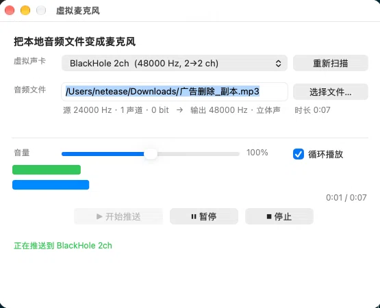

# VirtualMic

> Play any local audio file into your microphone — for macOS.

[](#requirements)
[](LICENSE)
[](#)

**English** · [中文说明](README.zh-CN.md)

VirtualMic routes a local audio file into a virtual audio device, so any app that
reads from that device — Zoom, Teams, OBS, WeChat, a browser, a recording tool —
hears your file as if it were a live microphone.

Think of it as the audio equivalent of OBS's virtual camera.

---

## Table of contents

- [What it does](#what-it-does)
- [How it works](#how-it-works)
- [Requirements](#requirements)
- [Quick start](#quick-start)
- [Usage](#usage)
  - [GUI](#gui)
  - [Command line](#command-line)
- [App does not list the virtual device](#app-does-not-list-the-virtual-device)
- [Building from source](#building-from-source)
- [Project layout](#project-layout)
- [Troubleshooting](#troubleshooting)
- [FAQ](#faq)
- [Contributing](#contributing)
- [License](#license)
- [Credits](#credits)

---

## What it does

- Decodes a local audio file (`mp3`, `m4a`, `aac`, `wav`, `aiff`, `flac`, …)
- Resamples it to the virtual device's rate, in real time
- Writes it to a loopback device's **output** side
- Any app can then pick that device as its **input** (microphone)

It does **not** modify your physical microphone. See
[FAQ](#why-cant-you-just-write-into-my-built-in-microphone) for why that is
impossible by design, not by permission.

## How it works

```
┌──────────────────┐
│  local audio file│
└────────┬─────────┘
         │  VMAudioFilePlayer
         │  decode → target rate / 2ch / Float32, pull-based
         ▼
┌──────────────────┐
│    VMRoute       │  CoreAudio HAL output AudioUnit
└────────┬─────────┘
         │  kAudioOutputUnitProperty_CurrentDevice
         ▼
┌──────────────────────────────────────┐
│  loopback device (e.g. BlackHole 2ch)│
│    Output side  ←── we write here    │
│    Input  side  ──→ apps read here   │
└──────────────────────────────────────┘
         ▲
         │  whichever app selects this as its microphone
    ┌────┴─────┐
    │ Zoom /   │
    │ OBS / …  │
    └──────────┘
```

There is no kernel extension and no custom driver: macOS already has loopback
devices, and this tool writes into one. See
[docs/architecture.md](docs/architecture.md) for the design decisions.

## Requirements

- macOS 10.13 or later
- A **loopback audio device**. macOS has none built in, so install one:
  - [BlackHole](https://github.com/ExistentialAudio/BlackHole) — recommended,
    free and open source. `scripts/install_blackhole.sh` builds and installs it
    for you.
  - or [Loopback](https://rogueamoeba.com/loopback/) (paid),
    [Soundflower](https://github.com/mattingalls/Soundflower) (unmaintained).
- For building: Xcode or the Xcode command line tools

> **Use the Xcode SDK, not the CommandLineTools SDK.** The latter's
> `CoreAudio.tbd` can fail with `tapi error: malformed file / unknown
> architecture`. `make` picks the SDK up via `xcrun --sdk macosx
> --show-sdk-path`, which resolves to the Xcode one.

## Quick start

### Option A — download the app

1. Grab `VirtualMic-<version>-macos.zip` from
   [Releases](https://github.com/wupeng1640/VirtualMic/releases) and unzip it.
2. **Right-click the app → Open → Open.** The first launch needs this: the build
   is not signed with an Apple Developer ID, so Gatekeeper blocks a plain
   double-click. See [docs/distribution.md](docs/distribution.md).
3. Install a loopback device if you have none — grab
   `VirtualMic-<version>-cli-macos.zip` and run `./install_blackhole.sh`, or use
   the source tree below.

Releases are universal (`arm64` + `x86_64`), so they run on Apple Silicon and
Intel Macs alike.

### Option B — build from source

```bash
git clone https://github.com/wupeng1640/VirtualMic.git
cd VirtualMic
make

# 1. install a loopback device (needs sudo; it will ask)
./scripts/install_blackhole.sh

# 2. check you can see it
./build/vmic --loops
```

A locally built app carries no quarantine flag, so it opens with a normal
double-click — if you would rather not do the right-click dance above, this is
the way.

Then either open `build/VirtualMic.app`, or push from the command line:

```bash
./build/vmic --play ~/Music/voice.mp3 --device "BlackHole 2ch"
```

Finally, in the app you want to feed (Zoom, Teams, OBS, …), set the microphone
to **BlackHole 2ch**.

## Usage

### GUI

```bash
make app
open build/VirtualMic.app
```

Pick a virtual device, pick a file, hit start. A level meter and a progress bar
show what is being sent.



### Command line

```
vmic --list                       list all audio devices
vmic --loops                      list usable virtual microphones only
vmic --play <file> [options]      start pushing
```

| Option | Meaning |
|---|---|
| `--device <name\|uid>` | Which virtual device to write to. Default: first loopback device found. |
| `--loop` | Loop the file forever |
| `--gain <n>` | Volume multiplier, default `1.0` |
| `--verify` | Also read back from the input side to prove the loopback is live |
| `--duration <sec>` | Stop after N seconds instead of playing to the end |
| `--rate <Hz>` | Target sample rate, default `48000` |

```bash
# loop a track into BlackHole
./build/vmic --play ~/Music/bgm.mp3 --device "BlackHole 2ch" --loop

# prove the signal actually arrives (prints a level from the input side)
./build/vmic --play ./voice.wav --device "BlackHole 2ch" --verify --duration 5
```

`--verify` is the honest check: it opens the device's **input** side and reports
the peak level it reads back. If that stays at zero, nothing is reaching the
device, no matter what the send counter says.

### Headless self-test

Useful in CI or over SSH — no window, no interaction:

```bash
./build/VirtualMic.app/Contents/MacOS/VirtualMic --selftest <file> [device]
```

It pushes for three seconds and prints the measured frame rate. Exit code is `0`
if the rate is within 5% of the device's sample rate.

## App does not list the virtual device

Some apps enumerate audio devices and then **discard every device whose
`kAudioDevicePropertyTransportType` is `'virt'`**. BlackHole is exactly that, so
it never shows up in their microphone dropdown — even though macOS itself sees
it fine.

The fix is to wrap BlackHole inside an **aggregate device**, whose transport type
is `'grup'` and which those apps do accept:

```bash
./scripts/make_agg.sh              # creates "BH Aggregate"
./scripts/make_agg.sh --remove     # removes it
./build/aggdev --list              # show every device and its transport type
```

`aggdev --list` marks the devices that are likely to be ignored, which makes this
quick to diagnose.

Aggregate devices do not survive a reboot. To recreate it at every login:

```bash
./scripts/install-agent.sh
```

Full write-up, including the log lines that prove it:
[docs/aggregate-device.md](docs/aggregate-device.md).

## Building from source

```bash
make            # everything: .app, vmic, aggdev
make app        # GUI only
make cli        # command-line tool only
make aggdev     # aggregate device helper only
make clean
make install    # install vmic and aggdev into /usr/local/bin
make ARCHS=arm64   # quicker local build, Apple Silicon only
```

`make` builds **universal** binaries (`arm64` + `x86_64`) so the same artifact
runs on both architectures.

To produce the release archives yourself:

```bash
./scripts/package.sh          # → dist/*.zip + SHA256SUMS.txt
```

There is no Xcode project — the whole thing is a `Makefile` and about 2,000
lines of Objective-C. Dependencies are system frameworks only.

## Project layout

```
.
├── Makefile                 build entry point
├── src/
│   ├── VMAudioDevice.{h,m}       CoreAudio device discovery / lookup by UID
│   ├── VMAudioFilePlayer.{h,m}   decode + real-time pull-based frame source
│   ├── VMRoute.{h,m}             HAL output AudioUnit, writes into the device
│   ├── VMAppDelegate.{h,m}       GUI app delegate + headless self-test
│   ├── VMMainWindowController.{h,m}  window, file picker, level meter
│   └── main.m                    command-line entry point
├── scripts/
│   ├── install_blackhole.sh  build & install BlackHole 2ch from source
│   ├── make_agg.sh           create/remove the aggregate device
│   ├── aggdev.m              aggregate device helper source
│   ├── install-agent.sh      LaunchAgent to recreate it at login
│   ├── uninstall-agent.sh
│   └── package.sh            build release archives into dist/
├── packaging/Info.plist      app bundle Info.plist
└── docs/
    ├── architecture.md       design and trade-offs
    ├── aggregate-device.md   the transport-type problem, with evidence
    ├── distribution.md       signing, notarisation, and why the first
    │                         launch needs right-click → Open
    └── faq.md
```

## Troubleshooting

**`vmic --loops` prints nothing**
No loopback device is installed. Run `./scripts/install_blackhole.sh`.

**Audio arrives but the other side hears nothing**
Check the app is reading from the *same* device you are writing to, and that its
input is not muted. `--verify` tells you whether the signal reaches the device at
all.

**A `.mp3` fails to open with `ExtAudioFileOpenURL=<number>`**
Some files have an `.mp3` extension but are actually M4A/AAC containers. The
player falls back to `AVAssetReader` automatically; if both decoders refuse, the
container is genuinely malformed — a third fallback through `ffmpeg` is not
implemented. Convert it first (`ffmpeg -i in.mp3 -ar 48000 out.wav`).

**It sounds like stuttering or clicks**
Raise `--rate` to match your device, or lower `--gain`. Very large files are
streamed, not buffered, so memory is not the issue.

**The aggregate device disappeared after a reboot**
Expected — install `./scripts/install-agent.sh`.

## FAQ

**Why can't you just write into my built-in microphone?**

Because it is physical hardware. No software can inject samples into it; the
signal path runs one way, from the microphone to the system. This is a design
property of macOS, not a permission you can grant. A virtual device is the only
way, and that is what every tool in this space does.

**Do I need to install a driver?**

Not one written by this project. You need *some* loopback device, and BlackHole
is the usual choice. Writing a HAL plugin from scratch would mean code signing,
notarisation, a reboot and disabling SIP — far more friction than the problem
deserves.

**Does it work with Apple Silicon?**

Yes. `scripts/install_blackhole.sh` builds a universal (`arm64` + `x86_64`)
driver.

**Is my audio uploaded anywhere?**

No. Nothing in this project opens a socket. Files are decoded locally and written
to a local audio device.

## Contributing

Issues and pull requests are welcome — see [CONTRIBUTING.md](CONTRIBUTING.md).
Build and run `make && make test FILE=<some audio file>` before opening a PR.

## License

[MIT](LICENSE).

## Credits

- [BlackHole](https://github.com/ExistentialAudio/BlackHole) — the loopback
  driver this project drives (GPL-3.0, separate work, not bundled here)
- Apple's CoreAudio / AudioToolbox frameworks
